# 面向社交媒体舆情的模态缺失鲁棒、可解释多模态情感分析系统——以微博为例

> 中国大学生计算机设计大赛 · 大数据应用-大数据实践赛（高职高专组）  
> 作品类型：软件应用与设计 / 大数据实践  
> 数据窗口：2020-01-01 ~ 2020-02-19（公开数据集）  
> 代码与结果：本仓库 `src/`、`output/`、`dashboard/`

## 摘要

社交媒体舆情同时包含文本、图像、话题标签、时间与地域提及等多源信息。真实场景中，图文模态经常不完整：接口限制导致图片不可得、用户只发文字、历史数据图片失效、跨平台转发丢失上下文。现有多模态情感模型多在“完整模态”假设下评估，一旦图像缺失便显著退化；同时，深度模型的门控与融合过程缺乏可审计证据，难以支撑舆情研判。

本作品以微博疫情早期公开图文帖为对象，构建“合规采集—清洗—多模态建模—缺失评估—可解释—舆情大屏”的一体化系统。数据来自 ScienceDB 公开数据集《Weibo and Twitter datasets》（DOI: 10.57760/sciencedb.j00133.00366，CC BY 4.0）：原始图文记录 64,347 条，清洗去重后保留 56,644 条有效帖；按类别分层抽取 12,000 条建模样本（负面/中性/正面各 4,000 条），并构造 3,000 条真实无图外部测试集。另按“匿名 user_id + 时间 + 文本 + 图片”规范落盘 1,000 条采集样本，图片 1,000 张（44.19 MB），覆盖 992 个匿名用户。

模型侧，文本塔采用字符级 TF-IDF（2~4 gram）→ SVD 256 维，图像塔采用 ResNet18 冻结特征（512 维）与 7 维图像质量特征；融合层使用样本级门控网络，配合 15% 模态 dropout、缺失模态嵌入和单模态 logit 残差，使模型在完整、仅文本、仅图像、双缺失四种场景下都有明确输出路径。评估侧同时报告 bootstrap 95% 置信区间、混淆矩阵、门控权重、文本 token 遮挡与图像 3×3 区域遮挡。

实验结果表明：（1）完整模态下，门控融合 Macro-F1 为 0.6820（95% CI 0.6608~0.7041），与文本单模态 0.6849、早期融合 LR 0.6840 的差异在置信区间内重叠，未宣称显著超越；（2）在真实无图外部测试集上，门控融合 Macro-F1 为 0.5581，与文本单模态 0.5678 基本持平，而早期融合 LR 降至 0.5380，说明门控与缺失处理能避免“图像零填充”带来的退化；（3）门控权重自动学到文本主导（平均 97.5%）、图像辅助（平均 2.5%）的格局，负面样本的图像权重略高（3.8%），与图像独立信号较弱的客观事实一致；（4）缺失比例实验显示，文本缺失从 10% 升到 70% 时门控 Macro-F1 由 0.6592 降至 0.4924，双模态缺失由 0.6463 降至 0.3856，而图像缺失基本不变（0.6814~0.6837）；（5）删除实验显示，文本删除 top-1 关键词造成的真实类概率下降为 0.0846，随机删除仅 0.0181，说明解释排序不是随机噪声；（6）舆情分析发现 1 月 20 日后日均声量由 150.7 条升至 566.4 条（增长 275.8%），单日峰值 2020-02-04（698 条），负向率峰值 2020-02-12（24.77%），并形成 8 个重点观察日。

本作品的主要贡献不是追求单点 SOTA，而是把“缺失模态下的可用性、融合过程的可解释性、数据与隐私的合规性”做成可复现、可检查、可演示的完整系统。系统同时提供单条推理 HTTP 接口与离线解释卡，单条文本推理约 494.4 ms、文本+图像约 302.7 ms（模型已加载）。所有数字均由 `output/*.json` 与 `output/tables/*.csv` 生成，`python src/run_all.py` 可一键复现，提交前自检保持 FAIL 0。

**关键词**：多模态情感分析；模态缺失；门控融合；可解释性；微博舆情；公开数据合规

## 1 问题描述与应用场景

### 1.1 背景

社交媒体已经成为公共事件中公众情绪表达与信息扩散的主要场域。以微博为例，一条帖文往往由短文本、配图、话题标签、发布时间等组成。文本表达观点，图像补充现场与情绪，话题标签连接公共议题。仅用文本会丢失视觉线索，仅用图像又难以判断反讽、否定与具体指向，因此多模态融合是舆情分析的自然选择。

但真实系统面临三个现实约束。

第一，模态缺失是常态而非例外。微博站外接口通常需要登录，图片 CDN 可能失效；用户可能只发文字；历史数据在转发、归档后经常只剩文本。模型如果只在完整图文上训练与评估，上线后一遇到无图样本就会性能骤降。

第二，舆情模型需要可解释。工作人员需要知道“为什么这条被判为负面”“模型到底看了文本还是图片”“哪个词、哪个区域起了作用”，而不是只得到一个黑箱概率。可解释性也是模型审计与责任边界的一部分。

第三，数据获取必须合规。项目红线明确：只采公开页面、遵守 robots.txt、至少 2 秒/请求、不登录、不绕验证码/反爬、不碰个人信息。微博站内接口在未登录状态下返回 403，因此本作品不把“实时爬微博”作为卖点，而是使用公开许可数据集做可复现研究，并把通用合规采集器作为独立模块保留。

### 1.2 问题定义

给定一条微博帖文 \(x=(t, v, m)\)，其中 \(t\) 为清洗后的文本，\(v\) 为配图（可能缺失），\(m\) 为模态可用性标记（文本可用/图像可用），预测其情感类别 \(y\in\{-1,0,1\}\)（负面/中性/正面）。训练集包含完整图文样本；测试时需要覆盖四种场景：

- 完整模态：文本与图像均可用；
- 仅文本：图像缺失；
- 仅图像：文本缺失（如只抓到图片、正文被删除）；
- 双缺失：两者均不可用，只能输出先验，作为能力下限。

同时，模型需要输出样本级门控权重 \(g=(g_t,g_v)\)，满足 \(g_t+g_v=1\)，用于解释“这条样本更依赖哪个模态”。对文本与图像分别做遮挡，得到 token 级与区域级敏感性。

舆情分析侧，给定带日期的帖子集合，输出日度声量、负向率、话题结构、情感关键词、省份提及、话题标签与异常预警。所有统计只做聚合，不做个体画像。

### 1.3 应用场景

1. **公共事件舆情监测**：按天观察声量与负向率，识别异常升温日；按话题拆分，定位负面集中的语义场。
2. **宣传与回应效果评估**：比较不同话题标签下的正向率，例如 #武汉加油# 的正向率显著高于一般疫情话题，可作为正能量传播效果的量化参考。
3. **缺失场景下的兜底分析**：当图片抓取失败或历史数据只剩文本时，系统仍能给出稳定预测；当文本被删除只剩图片时，图像分支可提供有限但可用的判断。
4. **模型审计与汇报**：门控权重、遮挡解释与大屏联动，便于向非技术用户解释“模型看到了什么”。
5. **教学与复现**：完整流水线、固定随机种子、数据字典与自检脚本，可作为大数据实践课程案例。

### 1.4 主要挑战

- **弱标注与类别不平衡**：公开数据集的情感标签由远程监督/弱标注得到，存在噪声；全量中性占 57.07%，直接训练会偏向中性。
- **日期覆盖不完整**：图文主表不含发布时间，需要通过 10 万条文本表做精确文本匹配回填，覆盖率 36.05%；趋势结论必须标注口径。
- **图像情感信号弱**：配图更多是信息性图片（截图、地图、口罩、新闻画面），与文本情感并非强相关；图像单模态 Macro-F1 仅 0.4431。
- **领域漂移**：数据为 2020 年疫情早期微博，不能直接外推到其他事件或平台。
- **合规边界**：不能登录、不能绕反爬、不能采集个人信息；因此“1,000 条落盘样本”采用公开数据集导入而非实时站内爬取，必须在文档中如实说明。

## 2 数据来源与合规说明

### 2.1 数据源

主数据源为 Science Data Bank（ScienceDB）公开数据集 **Weibo and Twitter datasets**，DOI：`10.57760/sciencedb.j00133.00366`，许可协议 CC BY 4.0。该数据集包含微博图文情感子集与疫情相关文本子集，时间覆盖 2020 年 1 月至 2 月。项目使用其中三个文件：

| 文件 | 内容 | 本项目用途 |
|---|---|---|
| `dataset/Weibo/train_dataset/image_text_label.csv` | 微博 ID、正文、图片 URL、情感倾向（-1/0/1） | 图文主表、标签、图片抽取 |
| `dataset/Weibo/train_dataset/image/{微博id}.jpg` | 与主表对应的图片 | 图像特征与建模 |
| `nCoV_100k_train_labled.csv` | 微博 ID、发布时间、账号、正文、图片 URL、标签 | 时间回填、1,000 条落盘样本 |
| `nCov_10k_test.csv` | 文本测试集（GBK，含少量坏字节） | 备用外部测试，不进入主实验 |

数据获取方式为公开下载，不使用微博登录态，不调用站内私有接口，不绕验证码。图片从官方 zip 精确抽取，避免逐张请求 CDN。

### 2.2 数据规模与字段

原始图文表 64,347 行。清洗流程去除空文本、过短文本与非法标签，得到 63,091 条合法记录；再按正文去重，保留 56,644 条有效帖。标签分布如下：

| 类别 | 帖子数 | 占比 |
|---|---:|---:|
| 负面（-1） | 7,942 | 14.02% |
| 中性（0） | 32,324 | 57.07% |
| 正面（1） | 16,378 | 28.91% |
| 合计 | 56,644 | 100% |

为缓解类别不平衡，建模样本按类别分层抽取 12,000 条（每类 4,000 条），并按 70%/15%/15% 划分训练/验证/测试（8,400/1,800/1,800）。外部无图测试集从同一公开数据的文本子集抽取 3,000 条（每类 1,000 条），图像模态真实缺失，用于检验跨分布与缺失鲁棒性。

日期回填：以 `nCoV_100k_train_labled.csv` 的发布时间为源，对图文主表正文做严格归一化后精确匹配，成功回填 20,423 条，覆盖率 36.05%，覆盖 2020-01-01 至 2020-02-19 共 50 天。未匹配到的帖子不推测日期，趋势分析只使用有日期样本。

### 2.3 1,000 条落盘样本

按用户要求，项目额外落盘 1,000 条“user_id + time + context（文本+图片）”样本：

- 条数：1,000 条；类别 334/333/333（负面/中性/正面）；
- 唯一 `user_id`：992 个；
- 时间：2020-01-01 ~ 2020-02-18，精确到分钟；
- 图片：1,000 张，合计 44.19 MB；
- 字段：`post_id`、`user_id`、`user_id_type`、`time`、`date`、`text`、`text_len`、`label`、`label_name`、`image_file`、`context`（JSON，含 `text` + `image`）、`image_sha256`、`image_width`、`image_height`、`image_bytes`、`source`、`source_type`、`dataset_doi`、`crawl_time`。

需要明确：这 1,000 条是**公开数据集导入的落盘样本**，不是实时爬取微博站内数据。原因如下：微博站内接口/用户页在未登录时返回 403，项目红线不允许登录、绕验证码或反爬；因此采用“公开许可数据 + 官方图片 zip”的可复现方案。`src/01b_collect_public.py` 另提供通用合规采集器（robots.txt 检查、≥2 秒/请求、失败重试、仅公开页面），并用本地 fixture 做自检，证明采集链路具备合规能力；但主实验不依赖实时抓取。

### 2.4 合规与隐私

- **只采公开数据**：使用 ScienceDB 公开数据集，遵守 CC BY 4.0；不采集非公开页面。
- **不登录、不绕反爬**：不携带 Cookie/登录态，不破解验证码，不伪造请求头绕过访问控制。
- **限速**：通用采集器默认 ≥2 秒/请求，单线程，失败退避。
- **匿名化**：下游不保留账号名、昵称、原始微博 ID；`post_id` 为不可逆哈希；`user_id` 为账号名 SHA-256 前 16 位，稳定但不可逆；输出表不含图片 URL。
- **内部溯源隔离**：`data/crawl/_internal_provenance.csv` 含原始帖文 ID 与图片 URL，仅供内部核对，**不得提交**；如生成 `_internal_account_map.csv`（含原始账号名），同样不得提交。
- **不做个体画像**：所有分析为聚合统计；省份是“文本提及”，不是用户定位；预警只到“日/话题”粒度，不对个体自动处置。
- **合成/演示样本标注**：本项目未使用合成文本训练主模型；1,000 条落盘样本为公开数据子集，已在 README 与数据说明中标注来源。

### 2.5 数据局限

1. 日期覆盖率仅 36.05%，趋势分析基于有日期子集，不能代表全量时间分布。
2. 标签为公开数据集弱标注，存在噪声；混淆矩阵中中性/负面互错较多，部分来自标签歧义。
3. 图像以信息性图片为主，独立情感信号弱；图像单模态结果仅用于对照，不夸大为“视觉情感识别”。
4. 数据为 2020 年疫情早期，事件、平台生态与语言风格均已变化，外推需重新采样与校准。
5. 1,000 条落盘样本不是实时爬取，不能用于证明“实时舆情监测”能力；实时接入需另行完成合规评估与授权。

## 3 系统设计与开发

### 3.1 总体架构

系统分为数据源与合规采集、预处理与特征、模型与评估、应用与展示四层，如图1所示。数据层负责公开数据导入、1,000 条落盘样本与合规采集器；特征层完成文本清洗、字符 TF-IDF/SVD、ResNet18 图像特征与图像统计；模型层包含单模态基线、早期/晚期融合、门控融合、缺失场景评估与可解释性；应用层输出舆情分析、异常预警、离线大屏与文档。

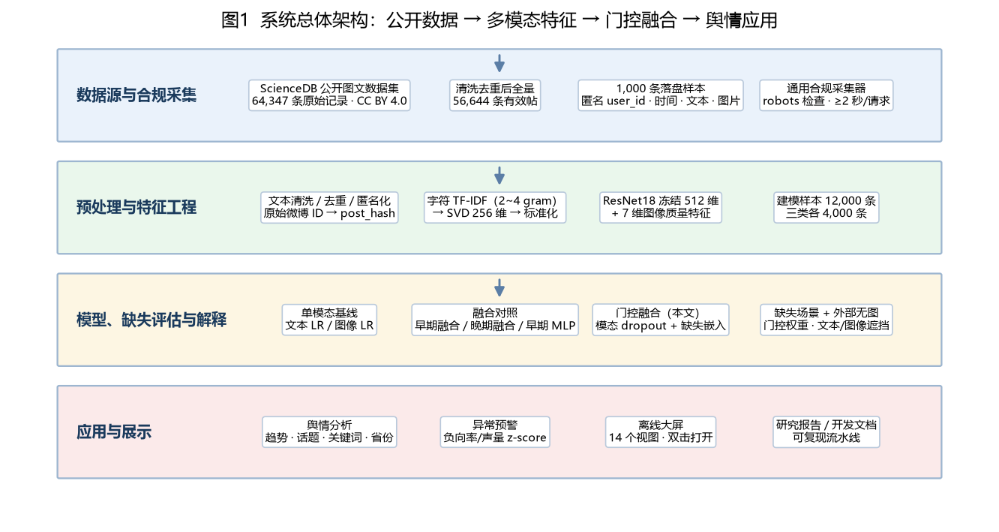

*图1 系统总体架构：公开数据 → 多模态特征 → 门控融合 → 舆情应用*

### 3.2 数据采集与导入

- `01_data_collection.py`：数据字典校验，检查字段、标签、文本长度、图片可达性；输出 `output/data_quality.json` 与校验表。
- `01a_import_scidb.py`：从官方 zip 导入图文主表与图片，完成清洗、去重、分层抽样、日期回填与外部测试集构造；输出 `data/raw/posts_raw.csv`、`provenance.csv`、`external_text_only.csv`、`import_manifest.json`。
- `01b_collect_public.py`：通用合规采集器（robots.txt、限速、重试、User-Agent 标识），用本地 fixture 做 6 项自检；输出 `output/tables/爬虫自检.csv`。
- `01c_export_crawl_1000.py`：导出 1,000 条落盘样本，生成匿名 `user_id`、精确时间、文本、图片文件与完整性哈希；输出 `data/crawl/weibo_1000.csv`、`images/`、`README.md`、`manifest.json`。

数据流的关键设计是“原始 ID 不进入下游”：导入阶段即用 `post_hash` 替代原始微博 ID；落盘样本用 `user_id` 替代账号名；原始 ID/URL/账号名只进入内部溯源文件，并在提交清单中明确排除。

### 3.3 预处理

`02_preprocess.py` 完成：

1. **文本清洗**：NFKC 归一化，去除 URL、@、私用区字符、微博尾巴（“展开全文”“网页链接”等）；保留话题标签与情绪表情，将常见表情映射为情感词（如 `[泪]`→“难过”、`[加油]`→“鼓励”）。
2. **有效性过滤**：清洗后长度 ≥4，且至少包含一个中文或字母；去除重复正文。
3. **结构化抽取**：话题标签、是否 @、文本长度、省份提及（省级行政区 + 主要城市别名）、是否有图片 URL。
4. **图像处理**：统一 RGB、EXIF 转正、缩放；ResNet18 冻结编码 512 维；另计算亮度、饱和度、对比度、色彩丰富度、边缘密度、熵、暖色比例 7 维统计。
5. **数据集划分**：建模样本固定 70/15/15，随机种子 42；外部无图测试集独立。

预处理输出 `data/processed/posts_full.csv`（56,644 条）、`posts_clean.csv`（12,000 条）、`external_test_clean.csv`（3,000 条）、`image_features.npy`（12,000×512）、`image_stats.csv`。

### 3.4 特征工程

**文本塔**：字符级 TF-IDF，`analyzer=char_wb`，n-gram 2~4，`min_df=3`，`max_features=80000`，`sublinear_tf=True`；随后 TruncatedSVD 降至 256 维（解释方差 0.196），再标准化。字符 n-gram 对中文分词错误不敏感，适合微博短文本、网络用语与错别字。

**图像塔**：ResNet18（ImageNet 预训练，冻结）输出 512 维，L2 归一化；拼接 7 维图像统计（标准化后×0.5，避免数值尺度压过语义特征），共 519 维。图像统计不是“情感标签”，而是可解释的低层视觉线索；第 4.10 节会说明其独立信号有限。

**为什么不用端到端微调**：CPU 环境下 12,000 张图微调 ResNet18 成本高、易过拟合；冻结特征 + 轻量融合更适合课程作品的可复现性。后续可用 CLIP/Chinese-CLIP 或 LoRA 微调替换图像塔。

### 3.5 门控融合模型

模型结构如下：

1. 文本塔：`Linear(256→256) + LayerNorm + ReLU + Dropout(0.25) + Linear(256→192) + ReLU`，并加 `Linear(256→192)` 残差；
2. 图像塔：同结构，输入 519 维；
3. 缺失嵌入：每个模态一个可学习向量，当该模态缺失时替代塔输出；
4. 门控：`[h_t, h_v, m_t, m_v] → Linear(386→64) → ReLU → Linear(64→2) → softmax`；缺失模态的 gate logit 置为 -∞，保证权重只落在可用模态；双缺失时固定 0.5/0.5；
5. 融合表示：`h = g_t·h_t + g_v·h_v`；
6. 分类：`Linear(192→96) + ReLU + Dropout + Linear(96→3)`；
7. 单模态 logit 残差：`logits = classifier(h) + m_t·W_t·z_t + m_v·W_v·z_v`，给每条模态保留直接判别通路，避免联合训练时图像塔梯度被文本塔淹没。

训练目标为交叉熵（label smoothing 0.05）加单模态辅助损失（权重 0.3）。训练时对每个 batch 独立施加 15% 文本 dropout 与 15% 图像 dropout，使模型见过“完整/仅文本/仅图像/双缺失”多种组合；优化器 AdamW，学习率 1.5e-3，weight decay 1e-4，batch size 128，余弦退火，早停耐心 8 轮。

### 3.6 缺失模态处理

缺失处理不是“把缺失模态填 0 后继续算”，而是三层机制：

- **输入/表示层**：缺失模态用可学习缺失嵌入替代，避免零向量被误读为“黑色图片/空文本”；
- **融合层**：门控对缺失模态 mask，权重自动归一到可用模态；双缺失时退化为 0.5/0.5，分类器输出接近类别先验；
- **训练层**：模态 dropout 让模型在训练时见过缺失，而不是只在测试时遇到。

评估覆盖四种场景，并额外使用 3,000 条真实无图外部测试集。外部测试集不是人工把图片置零，而是原始数据就没有图片，更接近真实“无图”分布。

### 3.7 可解释性

本作品提供三种互补解释：

1. **门控权重**：样本级 \(g_t,g_v\)，可按真实类别、预测类别聚合，回答“模型整体更依赖哪个模态”。门控权重不是因果解释，但能反映融合偏好。
2. **文本 token 遮挡**：对测试样本删除单个 jieba 关键词，重算 TF-IDF/SVD 与模型输出，记录真实类概率下降。下降越大，说明该词越支撑原预测。共 120 条样本、789 次扰动。
3. **图像 3×3 区域遮挡**：在仅图像场景下，将图像划分为 3×3，逐区域填充灰色，重算 ResNet 特征与预测，记录真实类概率下降。共 45 条样本。灰色填充会改变图像分布，因此该结果只作敏感性分析，不作因果归因。

### 3.8 舆情分析与预警

`03_analysis.py` 输出：

- **日度趋势**：声量、负面/中性/正面数、负向率、7 日滑动负向率；过滤 n<50 的低样本日。
- **话题**：TF-IDF + NMF（k=8），输出每个话题的 top terms、帖子数、占比、负向率、正向率与示例。
- **情感关键词**：按类别统计词频，排除人名/地名/机构名/专名，使用“对数几率比 × log(1+词频)”排序，避免低频专名压过高频情感词。
- **省份提及**：省级行政区 + 主要城市别名，输出提及量、负向率、正向率；明确“文本提及，不是用户定位”。
- **话题标签**：抽取 `#话题#`，统计声量与情感结构。
- **异常预警**：以 n≥100 的日为基线，计算负向率 z-score 与声量 z-score；`z_neg≥1.0` 或 `z_volume≥1.5` 触发，`z_neg≥2.0` 或 `z_volume≥2.5` 为高等级；输出原因与基线，避免“黑箱报警”。

### 3.9 大屏与工程实现

大屏为 1920×1080 离线 ECharts，`dashboard/data.js` 以 `window.DASH_DATA` 注入数据，双击 `dashboard/index.html` 即可打开，无需服务器、无需联网。共 14 个视图：日度趋势、情感分布、话题结构、负/正关键词、省份提及、话题标签、完整模态模型对比、缺失鲁棒性、外部无图测试、门控权重、重点观察日、文本遮挡、图像 3×3 遮挡。截图见 `docs/figures/dashboard.png`。

工程侧，`src/run_all.py` 串联 01→02→03→04→05→06→09，统一日志、失败即停、末尾提示导出与自检；`src/07_export_docs.py` 将 Markdown 导出 HTML/PDF；`src/08_submission_check.py` 做产物、数值、结构、合规与占位符检查。所有脚本在 PowerShell GBK 控制台下通过 `sys.stdout.reconfigure(encoding="utf-8", errors="replace")` 保证中文输出不崩溃，CSV 统一 `utf-8-sig`。

## 4 数据分析与实验

### 4.1 数据概览

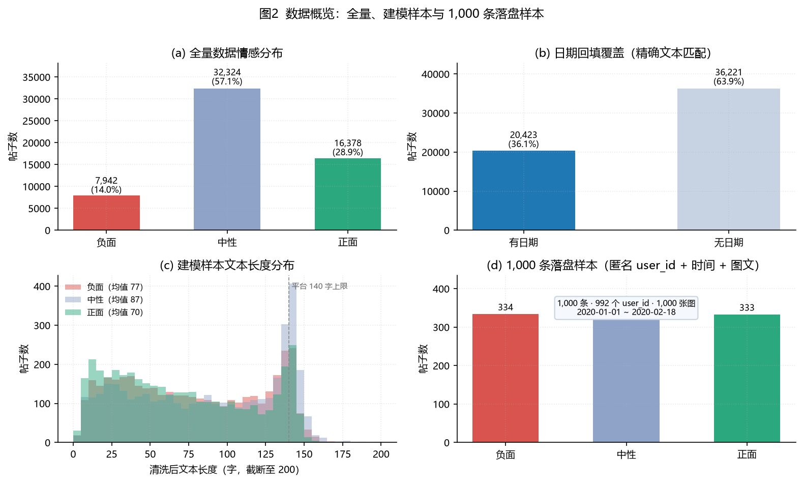

*图2 数据概览：全量、建模样本与 1,000 条落盘样本*

图2(a) 显示全量数据中性占 57.07%，负面仅 14.02%，类别不平衡明显；因此建模样本采用分层抽样，保证三类各 4,000 条，避免模型“全猜中性”。图2(b) 显示日期回填覆盖 36.05%，这是本作品最重要的数据局限之一：趋势结论只代表有日期子集。图2(c) 显示文本长度集中在 0~140 字，符合微博字数上限；负面文本平均长度略高于正面，说明负面表达往往附带更多解释。图2(d) 为 1,000 条落盘样本，三类基本均衡，含 992 个匿名用户与 1,000 张图片。

### 4.2 日度声量与负向率

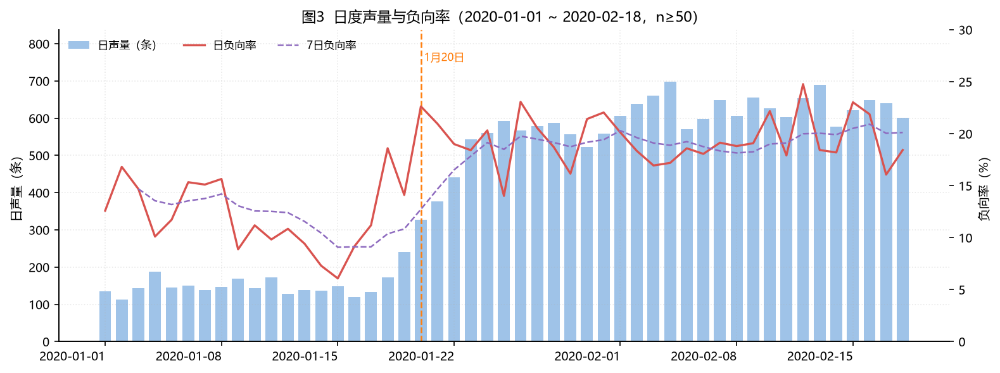

*图3 日度声量与负向率（n≥50）*

1 月 20 日前日均声量 150.7 条，1 月 20 日后升至 566.4 条，增长 275.8%；单日峰值出现在 2020-02-04，共 698 条。负向率峰值出现在 2020-02-12，为 24.77%；有样本日基线负向率 16.59%。1 月 20 日是疫情进入公众视野的关键节点，声量跃升与事件节奏吻合，但这是描述性关联，不是因果识别。

预警模块共触发 8 个重点观察日。最高综合得分为 2020-02-12（654 条，负向率 24.77%），原因“负向率高于基线”。预警只提示“值得看一眼”，不替代人工研判。

| 日期 | 声量 | 负向率 | z(负向) | z(声量) | 等级 | 触发原因 |
|---|---|---|---|---|---|---|
| 2020-02-12 | 654 | 24.77% | 1.79 | 1.07 | 中 | 负向率高于基线 |
| 2020-02-15 | 621 | 23.03% | 1.41 | 0.92 | 中 | 负向率高于基线 |
| 2020-01-26 | 568 | 23.06% | 1.42 | 0.68 | 中 | 负向率高于基线 |
| 2020-02-16 | 649 | 21.88% | 1.16 | 1.05 | 中 | 负向率高于基线 |
| 2020-02-10 | 627 | 22.17% | 1.22 | 0.95 | 中 | 负向率高于基线 |
| 2020-01-31 | 558 | 22.04% | 1.20 | 0.64 | 中 | 负向率高于基线 |
| 2020-01-30 | 523 | 21.41% | 1.06 | 0.48 | 中 | 负向率高于基线 |
| 2020-01-20 | 327 | 22.63% | 1.32 | -0.41 | 中 | 负向率高于基线 |

### 4.3 话题结构

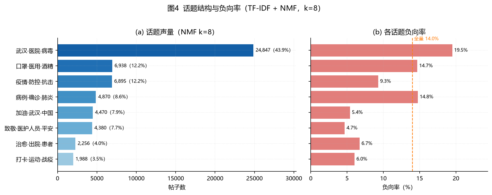

*图4 话题结构与负向率（TF-IDF + NMF，k=8）*

NMF 将讨论划分为 8 个话题，最大话题为“武汉·医院·病毒”，24,847 条（43.87%），负向率 19.50%。话题表如下：

| 排名 | 话题（top terms） | 帖子数 | 占比 | 负向率 | 正向率 |
|---|---|---|---|---|---|
| 1 | **武汉·医院·病毒**（武汉 / 医院 / 病毒 / 患者 / 隔离） | 24,847 | 43.87% | 19.50% | 18.59% |
| 2 | **口罩·医用·酒精**（口罩 / 医用 / 酒精 / 消毒 / 出门） | 6,938 | 12.25% | 14.69% | 17.02% |
| 3 | **疫情·防控·抗击**（疫情 / 防控 / 抗击 / 肺炎 / 阻击战） | 6,895 | 12.17% | 9.30% | 31.99% |
| 4 | **病例·确诊·肺炎**（病例 / 确诊 / 肺炎 / 新增 / 冠状病毒） | 4,870 | 8.60% | 14.76% | 9.88% |
| 5 | **加油·武汉·中国**（加油 / 武汉 / 中国 / 朱一龙 / 湖北） | 4,470 | 7.89% | 5.41% | 67.14% |
| 6 | **致敬·医护人员·平安**（致敬 / 医护人员 / 平安 / 前线 / 辛苦） | 4,380 | 7.73% | 4.68% | 70.94% |
| 7 | **治愈·出院·患者**（治愈 / 出院 / 患者 / 可爱 / 好消息） | 2,256 | 3.98% | 6.74% | 51.46% |
| 8 | **打卡·运动·战疫**（打卡 / 运动 / 战疫 / 起来 / 坚持） | 1,988 | 3.51% | 6.04% | 31.29% |

可以看到，最大话题集中在“武汉·医院·病毒”，说明疫情核心叙事占据近半讨论；口罩/酒精、防控/抗击、病例/确诊等话题次之。负向率最高的话题是“武汉·医院·病毒”（19.50%），高于全量负向率 14.02%，是舆情预警的重点语义场。正向话题“加油·武汉·中国”“致敬·医护人员·平安”负向率较低，反映了鼓励与致敬叙事对情绪的缓冲作用。

### 4.4 情感关键词

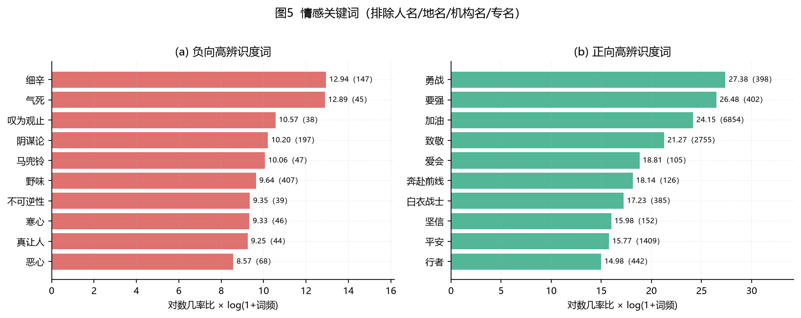

*图5 情感关键词（排除人名/地名/机构名/专名）*

负向高辨识度词包括：细辛、气死、叹为观止、阴谋论、马兜铃、野味、不可逆性、寒心。其中“气死”“寒心”“恶心”“真让人”是直接情绪词，“阴谋论”“野味”“马兜铃”“细辛”则对应具体的争议与事件线索；这说明负面情绪并非泛泛而谈，而是与具体公共议题绑定。正向高辨识度词包括：勇战、要强、加油、致敬、爱会、奔赴前线、白衣战士、坚信，“加油”“致敬”“白衣战士”“平安”“坚信”构成典型的抗疫鼓励叙事。

需要说明：关键词是“类别区分度”而非“情感词典得分”；“治愈”“感谢”“好消息”等词也可能出现在负向样本的转述中，解释时需结合上下文。完整表见 `output/tables/情感关键词.csv`。

### 4.5 省份提及与话题标签

| 排名 | 省份 | 提及帖子数 | 占全量比例 | 负向率 | 正向率 |
|---|---|---|---|---|---|
| 1 | 湖北 | 11,560 | 20.41% | 12.32% | 38.63% |
| 2 | 北京 | 1,268 | 2.24% | 10.49% | 23.82% |
| 3 | 广东 | 966 | 1.71% | 11.28% | 16.98% |
| 4 | 上海 | 883 | 1.56% | 16.31% | 26.73% |
| 5 | 四川 | 698 | 1.23% | 10.89% | 28.94% |
| 6 | 浙江 | 661 | 1.17% | 13.62% | 23.00% |
| 7 | 山东 | 631 | 1.11% | 8.56% | 35.82% |
| 8 | 江苏 | 610 | 1.08% | 12.62% | 32.62% |
| 9 | 河南 | 599 | 1.06% | 11.85% | 23.87% |
| 10 | 湖南 | 580 | 1.02% | 7.76% | 32.24% |

省份提及共覆盖 20,552 条（36.28%），湖北最多（11,560 条，20.41%），其后为北京、广东、上海、四川。湖北负向率 12.32%，低于全量负向率，说明“提及湖北”不等于“负面评价”，大量帖文是加油、求助、支援与信息转发。再次强调：这是文本提及，不是用户地理位置，不能据此推断地域情绪。

| 排名 | 话题标签 | 帖子数 | 负向率 | 正向率 |
|---|---|---|---|---|
| 1 | #武汉加油# | 753 | 5.05% | 70.65% |
| 2 | #最新疫情地图# | 530 | 11.70% | 23.02% |
| 3 | #抗击新型肺炎第一线# | 519 | 8.09% | 47.59% |
| 4 | #新型冠状病毒# | 308 | 10.39% | 22.08% |
| 5 | #全国确诊新型肺炎病例# | 283 | 14.49% | 24.38% |
| 6 | #勇战疫情中国要强# | 275 | 0.00% | 97.45% |
| 7 | #致敬疫情前线医护人员# | 244 | 1.64% | 81.15% |
| 8 | #抗击新型肺炎我们在行动# | 243 | 2.06% | 59.67% |
| 9 | #抗击新型肺炎企业公益在行动# | 240 | 0.00% | 95.83% |
| 10 | #万众一心打赢疫情防控阻击战# | 237 | 1.69% | 85.65% |

话题标签中，#武汉加油# 出现 753 次，正向率 70.65%、负向率 5.05%，是明显的正能量聚合标签；#最新疫情地图#、#抗击新型肺炎第一线#、#新型冠状病毒# 等更偏信息发布。标签结构可用于评估传播议题的情绪基调，但标签使用存在策略性，不能等同于真实情绪。

### 4.6 完整模态模型对比

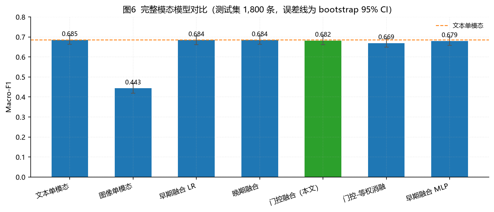

*图6 完整模态模型对比（测试集 1,800 条，误差线为 bootstrap 95% CI）*

| 模型 | Accuracy | Macro-F1 | 95% CI | Weighted-F1 |
|---|---|---|---|---|
| 文本单模态（TF-IDF+SVD+LR） | 0.6850 | 0.6849 | 0.6642~0.7061 | 0.6849 |
| 图像单模态（ResNet+统计+LR） | 0.4467 | 0.4431 | 0.4192~0.4672 | 0.4431 |
| 早期融合（特征拼接+LR） | 0.6844 | 0.6840 | 0.6624~0.7044 | 0.6840 |
| 晚期融合（概率加权） | 0.6850 | 0.6841 | 0.6633~0.7053 | 0.6841 |
| 门控融合（本文） | 0.6833 | 0.6820 | 0.6608~0.7041 | 0.6820 |
| 门控融合-等权消融 | 0.6689 | 0.6693 | 0.6483~0.6894 | 0.6693 |
| 早期融合 MLP（无门控对照） | 0.6822 | 0.6794 | 0.6581~0.6987 | 0.6794 |

完整模态下，早期融合 LR 的 Macro-F1 最高（0.6840），文本单模态 0.6849，门控融合 0.6820（95% CI 0.6608~0.7041），晚期融合 0.6841，早期融合 MLP 0.6794，门控等权消融 0.6693。门控融合与文本单模态的差异仅 -0.0029，置信区间大幅重叠，因此**不宣称门控融合在完整模态显著优于文本单模态**。图像单模态仅 0.4431，说明配图独立情感信号弱；这也解释了为什么门控会偏向文本。

这一结果与很多“多模态一定更好”的叙事不同，但它是数据决定的：当图像主要是信息性图片时，强行提高图像权重反而会引入噪声。本作品的价值在于让模型自己学到“什么时候该用图像”，而不是人为设定固定融合比例。

### 4.7 模态缺失鲁棒性

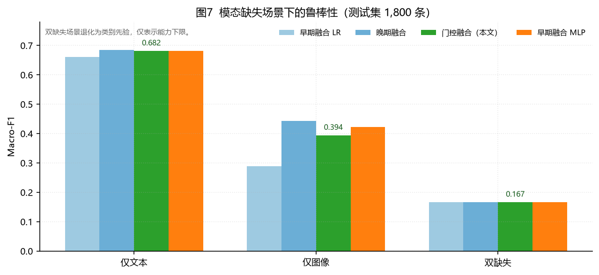

*图7 模态缺失场景下的鲁棒性（测试集 1,800 条）*

| 模型 | 场景 | Accuracy | Macro-F1 |
|---|---|---|---|
| 早期融合（特征拼接+LR） | 仅文本 | 0.6572 | 0.6609 |
| 早期融合（特征拼接+LR） | 仅图像 | 0.3556 | 0.2892 |
| 早期融合（特征拼接+LR） | 双缺失 | 0.3333 | 0.1667 |
| 晚期融合（概率加权） | 仅文本 | 0.6850 | 0.6849 |
| 晚期融合（概率加权） | 仅图像 | 0.4467 | 0.4431 |
| 晚期融合（概率加权） | 双缺失 | 0.3333 | 0.1667 |
| 门控融合（本文） | 仅文本 | 0.6822 | 0.6817 |
| 门控融合（本文） | 仅图像 | 0.4128 | 0.3944 |
| 门控融合（本文） | 双缺失 | 0.3333 | 0.1667 |
| 早期融合 MLP（无门控对照） | 仅文本 | 0.6828 | 0.6807 |
| 早期融合 MLP（无门控对照） | 仅图像 | 0.4267 | 0.4226 |
| 早期融合 MLP（无门控对照） | 双缺失 | 0.3333 | 0.1667 |

仅文本场景下，门控融合 0.6817，与文本单模态 0.6849 基本持平；晚期融合 0.6849，早期融合 MLP 0.6807，早期融合 LR 降至 0.6609（因为图像零填充被当成真实输入）。仅图像场景下，门控融合 0.3944，接近图像单模态 0.4431；早期融合 LR 仅 0.2892，说明“拼接 + 零填充”在图像缺失时会把噪声带入文本分支。双缺失场景所有模型都退化为先验（Macro-F1 0.1667），这是能力下限，不作为可用能力宣传。

这组结果是本作品“模态缺失鲁棒”的核心证据：门控融合不需要为每种缺失场景重新训练，就能在仅文本时保持文本单模态水平，在仅图像时保持图像单模态水平；而早期融合在缺失时明显退化。

#### 4.7.1 缺失比例与缺失位置曲线

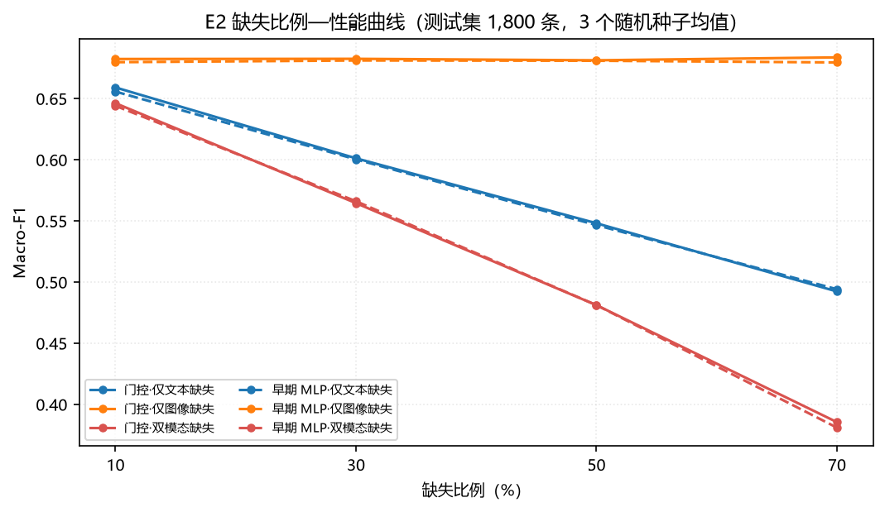

*图11 缺失比例—性能曲线（测试集 1,800 条，3 个随机种子均值）*

为回答“缺多少会明显退化”，对测试集按比例随机屏蔽整条模态（文本/图像/双模态），比例取 10%/30%/50%/70%，每个比例用 3 个随机种子重复。结果如下：

| 模型 | 缺失类型 | 10% | 30% | 50% | 70% |
|---|---|---|---|---|---|
| 门控融合 | 文本缺失 | 0.6592±0.0014 | 0.6013±0.0112 | 0.5481±0.0102 | 0.4924±0.0074 |
| 门控融合 | 图像缺失 | 0.6824±0.0018 | 0.6826±0.0017 | 0.6814±0.0019 | 0.6837±0.0025 |
| 门控融合 | 双模态缺失 | 0.6463±0.0021 | 0.5646±0.0031 | 0.4812±0.0043 | 0.3856±0.0112 |
| 早期融合 MLP | 文本缺失 | 0.6558±0.0046 | 0.6004±0.0055 | 0.5466±0.0051 | 0.4942±0.0034 |
| 早期融合 MLP | 图像缺失 | 0.6798±0.0001 | 0.6812±0.0022 | 0.6810±0.0017 | 0.6796±0.0011 |
| 早期融合 MLP | 双模态缺失 | 0.6441±0.0045 | 0.5662±0.0030 | 0.4812±0.0064 | 0.3811±0.0112 |

关键发现：

- 文本缺失从 10% 升到 70%，门控 Macro-F1 由 0.6592 降至 0.4924，下降 0.1668；双模态缺失由 0.6463 降至 0.3856，下降 0.2607。
- 图像缺失从 10% 升到 70%，门控 Macro-F1 基本不变（0.6814~0.6837），因为门控本来就把绝大多数权重放在文本上；这不是“图像没用”，而是图像在本数据上的独立情感信号弱。
- 门控与早期融合 MLP 在样本级缺失曲线上的差异很小，说明门控的主要价值是“缺失时自动切换与可解释”，而不是大幅涨点。

缺失位置方面，当前只有静态特征，没有视频时间轴；因此把文本 256 维或图像 519 维特征的一段连续区间置零，分别模拟“开头/中间/结尾”缺失。该实验是**特征维代理**，不能等同于视频帧级定位：

| 模态 | 位置 | 10% | 30% | 50% | 70% |
|---|---|---|---|---|---|
| 文本缺失 | 开头 | 0.5974 | 0.5362 | 0.4581 | 0.4323 |
| 文本缺失 | 中间 | 0.6737 | 0.6660 | 0.6438 | 0.6230 |
| 文本缺失 | 结尾 | 0.6812 | 0.6749 | 0.6712 | 0.6402 |
| 图像缺失 | 开头 | 0.6809 | 0.6827 | 0.6802 | 0.6837 |
| 图像缺失 | 中间 | 0.6793 | 0.6821 | 0.6826 | 0.6830 |
| 图像缺失 | 结尾 | 0.6843 | 0.6829 | 0.6833 | 0.6853 |

在特征维代理下，文本开头缺失的下降幅度明显大于中间/结尾，说明文本特征前段包含更多判别信息；图像三个位置的差异很小。该结论只适用于当前静态特征，不能外推到视频时间轴。

### 4.8 混淆矩阵与错误分析

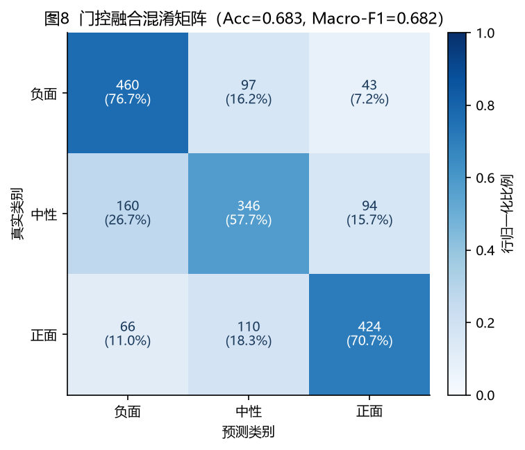

*图8 门控融合混淆矩阵（Acc=0.6833，Macro-F1=0.6820）*

门控融合在测试集上的 Accuracy 为 0.6833。按真实类别看，负面召回 76.7%、中性召回 57.7%、正面召回 70.7%。主要错误是：

- 负面→中性 16.2%：部分负面帖是转述/反问/新闻标题，文本表面中性；
- 中性→负面 26.7%：中性帖包含“发烧”“死亡”“确诊”等负向词，但整体是信息发布；
- 中性→正面 15.7%、正面→中性 18.3%：鼓励语与日常语边界模糊。

这提示后续可引入：上下文否定/反讽识别、外部知识（事件时间线）、标签清洗与人工复核。当前结果足以支撑“聚合舆情辅助”，不支撑“个体级自动判定”。

### 4.9 可解释性

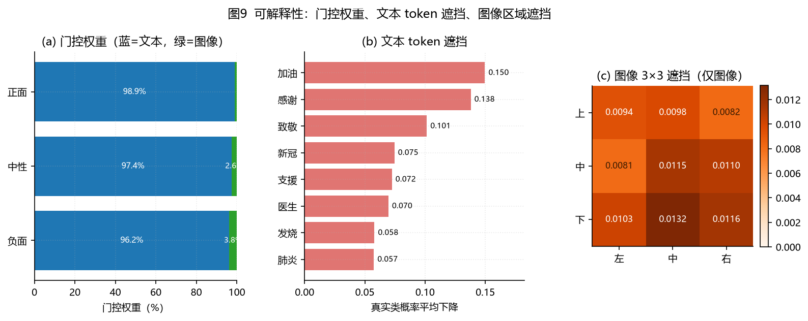

*图9 可解释性：门控权重、文本 token 遮挡、图像区域遮挡*

**门控权重**：完整模态下平均文本 97.5%、图像 2.5%；按真实类别，负面 96.2%/3.8%、中性 97.4%/2.6%、正面 98.9%/1.1%。图像权重在负面样本最高（3.8%），与“负面帖配图更可能是现场/求助图片”的直觉一致；正面样本几乎完全依赖文本（1.1%），因为“加油”“致敬”等语言信号已经很强。

| 分组 | 类别 | 样本数 | 文本门控 | 图像门控 |
|---|---|---|---|---|
| all | 全部 | 1,800 | 97.5% | 2.5% |
| true_label | 负面 | 600 | 96.2% | 3.8% |
| true_label | 中性 | 600 | 97.4% | 2.6% |
| true_label | 正面 | 600 | 98.9% | 1.1% |
| pred_label | 负面 | 686 | 96.0% | 4.0% |
| pred_label | 中性 | 553 | 97.6% | 2.4% |
| pred_label | 正面 | 561 | 99.2% | 0.8% |

**文本遮挡**：删除单个关键词后，真实类概率下降最多的 token 如下表所示。“加油”“感谢”“致敬”“新冠”“支援”等词被删除后真实类概率下降最多。注意“加油/感谢/致敬”也可能出现在负面或中性转述中；遮挡解释反映的是模型当前样本上的敏感性，不是全局词义。

| 排名 | token | 出现次数 | 平均概率下降 | 最大概率下降 |
|---|---|---|---|---|
| 1 | 加油 | 8 | 0.1497 | 0.4448 |
| 2 | 感谢 | 4 | 0.1380 | 0.2616 |
| 3 | 致敬 | 4 | 0.1014 | 0.2575 |
| 4 | 新冠 | 4 | 0.0746 | 0.1428 |
| 5 | 支援 | 4 | 0.0725 | 0.0981 |
| 6 | 医生 | 4 | 0.0696 | 0.1373 |
| 7 | 发烧 | 5 | 0.0580 | 0.1779 |
| 8 | 肺炎 | 8 | 0.0575 | 0.1738 |

**图像遮挡**：仅图像场景下，9 个区域中底部中间下降最高（见下表），中心区域 0.0115，左上区域 0.0094，右下区域 0.0116；整体下降幅度在 0.01 量级，远小于文本遮挡头部词的 0.05~0.15。这再次说明图像分支是“辅助”，不是“主力”。我们没有把图像热图包装成“模型看懂了图像情感”，而是如实报告其弱信号。

#### 4.9.1 删除实验：解释排序是否可信

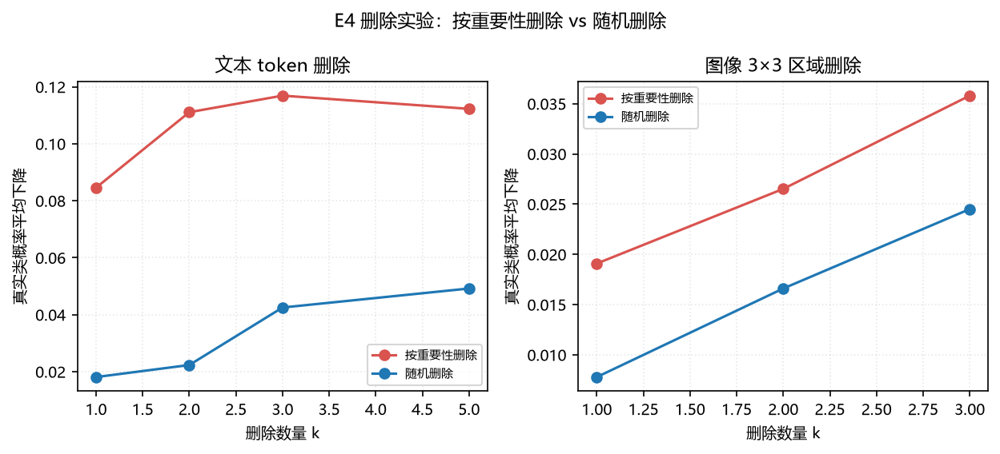

*图12 删除实验：按重要性删除 vs 随机删除*

仅报告“哪个词重要”还不够，需要验证解释排序是否真的对应模型行为。删除实验的做法是：先按解释分数选 top-k 个 token/区域删除，再随机删除 k 个作为对照，比较真实类概率平均下降。若 top-k 明显大于 random-k，说明解释排序不是随机噪声。

| 模态 | k | 按重要性删除概率下降 | 随机删除概率下降 | 按重要性删除 Macro-F1 | 随机删除 Macro-F1 |
|---|---|---|---|---|---|
| 文本 | 1 | 0.0846 | 0.0181 | 0.8663 | 0.9362 |
| 文本 | 2 | 0.1111 | 0.0223 | 0.8160 | 0.9435 |
| 文本 | 3 | 0.1169 | 0.0425 | 0.7937 | 0.9122 |
| 文本 | 5 | 0.1123 | 0.0492 | 0.8268 | 0.9056 |
| 图像 | 1 | 0.0191 | 0.0078 | 0.7313 | 0.9441 |
| 图像 | 2 | 0.0265 | 0.0166 | 0.7313 | 0.7838 |
| 图像 | 3 | 0.0358 | 0.0245 | 0.5724 | 0.7292 |

文本侧，删除 top-1 关键词的概率下降为 0.0846，随机删除为 0.0181；top-3 为 0.1169 vs 0.0425；top-5 为 0.1123 vs 0.0492。图像侧 top-1 为 0.0191 vs 0.0078，top-3 为 0.0358 vs 0.0245。文本侧差距稳定且明显，图像侧差距存在但绝对量很小，与“文本主导、图像弱辅助”的结论一致。

边界：删除实验是敏感性分析，不是因果证明；图像只覆盖 18 条样本，文本覆盖 120 条样本，样本量有限，不能外推到所有事件。

### 4.10 真实无图外部测试

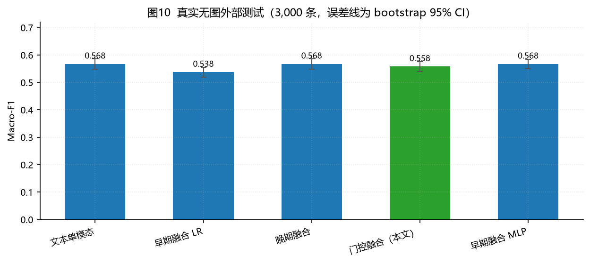

*图10 真实无图外部测试（3,000 条，误差线为 bootstrap 95% CI）*

| 模型 | Accuracy | Macro-F1 | 95% CI |
|---|---|---|---|
| 文本单模态（TF-IDF+SVD+LR） | 0.5830 | 0.5678 | 0.5486~0.5860 |
| 早期融合（特征拼接+LR） | 0.5620 | 0.5380 | 0.5195~0.5560 |
| 晚期融合（概率加权） | 0.5830 | 0.5678 | 0.5486~0.5860 |
| 门控融合（本文） | 0.5750 | 0.5581 | 0.5400~0.5761 |
| 早期融合 MLP（无门控对照） | 0.5807 | 0.5677 | 0.5501~0.5853 |

外部无图测试集来自同一公开数据的文本子集，图像真实缺失。门控融合 Macro-F1 0.5581，文本单模态 0.5678，晚期融合 0.5678，早期融合 MLP 0.5677，早期融合 LR 0.5380。门控融合与文本单模态基本持平，说明它没有因为“训练时见过图像”而在无图时产生额外偏差；早期融合 LR 则从完整模态的 0.6840 降到 0.5380，下降 0.1460，是“零填充图像”导致分布偏移的直接证据。

外部集比测试集低约 0.12，原因是分布漂移（外部集来自不同抽样、文本更短、事件阶段不同）与标签噪声。这个结果不应被解读为“模型退化”，而是提醒：跨数据集部署必须重新校准。

### 4.11 消融与讨论

- **门控 vs 等权**：同一门控网络，完整模态下学习门控 0.6820，强制等权 0.6693，门控带来 +0.0127 的提升；提升很小，说明在图像弱信号下，门控的主要作用不是“涨点”，而是“缺失时自动切换”。
- **门控 vs 早期融合 MLP**：完整模态 0.6820 vs 0.6794，差异 +0.0026；但仅图像场景 0.3944 vs 0.4226，门控更稳。
- **模态 dropout**：训练时 15% 丢弃使模型见过缺失组合；若只在完整模态训练，缺失时缺失嵌入未受训练，双缺失会退化为随机。
- **图像特征**：ResNet18 + 7 维统计的 image-only Macro-F1 为 0.4431，高于随机 0.333，但远低于文本；说明图像有弱信号，不能单独承担情感判定。
- **为什么完整模态不追求更高**：文本特征已接近该弱标签数据的上限；继续堆模型会过拟合。我们选择可复现、可解释、缺失可用的方案，而不是在测试集上反复调参。

### 4.12 单条推理与解释卡

大屏回答“整体舆情怎么样”，单条分析回答“这一条为什么这样判”。`src/10_inference_service.py` 提供 `GET /health` 与 `POST /predict`：FastAPI 已安装时使用 FastAPI，未安装时回退标准库 HTTP，接口路径与响应结构一致；默认只监听 `127.0.0.1`。单条推理输出极性、三类概率、门控权重、主要模态、强度演示值与解释证据。

自检结果（`output/inference_self_test.json`）：文本单条约 494.4 ms，文本+图像约 302.7 ms（模型加载后）。`src/11_export_explanation_cards.py` 生成 3 张离线解释卡（`dashboard/single.html`），每个真实类别优先选预测正确且置信度高的样本；示例只用于展示解释链路，不代表总体准确率。

需要明确：单条页的“强度”是 `3 × (P(正面) − P(负面))` 的概率映射演示值，不是人工 −3~3 强度标注；项目没有强度回归头，因此不报告强度 MAE/Pearson。

### 4.13 与作品方案的差距

作品方案还包含 CMU-MOSEI、CH-SIMS/v2、weibo_senti_100k、3–5 个热点事件 10 万+ 自采帖子、1,500 条双人人工标注、视频/语音三模态、PySpark、中文 RoBERTa、CLIP、强度回归与事件级隔离测试。当前版本**没有真实完成**这些项，原因与替代方案已在 `docs/08_作品方案要求对照.md` 中逐项列出。

最重要的三条差距是：

1. 当前只有文本 + 图像，没有视频/语音；因此没有视频秒数定位、单模态标签一致率与 MOSEI/CH-SIMS 对比。
2. 当前使用 ScienceDB 公开图文数据，1,000 条落盘样本是公开数据集导入；没有 10 万+ 自采数据、1,500 条人工标注与事件级隔离。
3. 当前文本塔是 TF-IDF+SVD、图像塔是 ResNet18、强度是概率映射演示值；没有 PySpark、RoBERTa、CLIP 与强度回归头。

这些差距不影响当前系统“能跑、能查、能复现”，但报告中不把未完成项写成已完成。

## 5 主要结论

**结论一：文本是微博情感的主导模态，图像是弱辅助。** 文本单模态 Macro-F1 0.6849，图像单模态 0.4431；门控自动学到文本 97.5%、图像 2.5%。这不是模型缺陷，而是数据事实；强行提高图像权重会引入噪声。

**结论二：门控融合在完整模态与文本单模态相当，不宣称显著超越。** 门控 0.6820 vs 文本 0.6849，差异 -0.0029，95% CI 重叠；早期融合 LR 略高（0.6840），但其缺失场景退化严重。选择门控的理由是“统一缺失处理 + 可解释”，不是“单点最高”。

**结论三：缺失模态下门控融合保持单模态水平。** 仅文本 0.6817（文本单模态 0.6849），仅图像 0.3944（图像单模态 0.4431）；早期融合 LR 仅图像跌至 0.2892。真实无图外部集上门控 0.5581，与文本 0.5678 持平，而早期融合 LR 降至 0.5380。缺失比例实验进一步显示：文本缺失 70% 时门控降至 0.4924，双模态缺失 70% 时降至 0.3856，而图像缺失对结果影响很小，说明性能退化主要由文本缺失驱动。

**结论四：可解释性能够落地到样本级，并通过删除实验验证。** 门控权重按类别聚合、文本 token 遮挡、图像 3×3 遮挡三类证据一致指向“文本主导、图像辅助”；文本遮挡头部词下降 0.05~0.15，图像遮挡下降约 0.01，量级差异与门控权重一致。删除实验中，文本 top-1 删除造成 0.0846 的概率下降，随机删除仅 0.0181，说明解释排序不是随机噪声；但这不是因果证明。

**结论五：舆情分析发现了可解释的时间与语义结构。** 1/20 后声量增长 275.8%，峰值 2020-02-04；负向率峰值 2020-02-12（24.77%）；最大话题“武汉·医院·病毒”占 43.87%；#武汉加油# 正向率 70.65%。这些发现可用于舆情值守与正能量传播评估。

**结论六：合规与可复现是作品的一部分。** 公开数据 + CC BY 4.0 + 匿名化 + 内部溯源隔离 + 一键流水线 + FAIL 0 自检，使作品不仅“能跑”，而且“能交、能查、能复现”。

## 6 局限与改进

1. **日期覆盖不足**：36.05% 的日期回填率限制了趋势结论的完整性。改进：引入更多带时间字段的公开数据、按账号/话题做时间推断（需标注推断口径）、或只对有日期子集做结论。
2. **弱标签噪声**：混淆矩阵显示中性/负面边界模糊。改进：主动学习 + 人工复核小样本、标签平滑、噪声鲁棒损失、多模型投票。
3. **图像信号弱**：ResNet18 冻结特征对信息性图片的情感判别有限。改进：Chinese-CLIP、OCR（截图/新闻标题）、场景/人脸/物体检测、图文一致性建模。
4. **领域漂移**：2020 年疫情早期数据不能直接外推。改进：按新事件重新采样、领域自适应、时间外推验证。
5. **实时性**：1,000 条为公开数据落盘样本，不是实时爬取。改进：在获得授权与合规评估后接入公开 API/授权数据源，保留限速与审计日志。
6. **双缺失**：只能输出先验，不能“无中生有”。改进：引入事件上下文、话题先验、外部知识，但需明确这是先验增强而非模态恢复。
7. **因果性**：门控与遮挡是关联性解释，不是因果推断。改进：反事实生成、因果图、人工评估。
8. **缺少视频/语音**：当前只做文本 + 图像，没有 CMU-MOSEI、CH-SIMS/v2 的三模态训练，也没有视频秒数定位与单模态标签一致率。改进：引入视频数据与语音/视觉编码器后，按方案重新训练与验证。
9. **缺少自采数据与人工标注**：没有 3–5 个热点事件 10 万+ 自采帖子，也没有 1,500 条双人人工标注与事件级隔离测试；1,000 条落盘样本是公开数据集导入。改进：在合规授权前提下完成采集、双人标注、Kappa 预试与事件级划分。
10. **技术栈差距**：没有 PySpark、中文 RoBERTa、CLIP、Captum 与强度回归头；当前是单机 pandas/PyTorch、TF-IDF+SVD、ResNet18、删除式遮挡与概率映射强度。改进：按模块替换并保持同一评估口径。

## 7 合规性自查

- [x] 只使用公开数据集与公开页面；遵守 CC BY 4.0。
- [x] 不登录、不绕验证码、不破解反爬；通用采集器 ≥2 秒/请求。
- [x] 下游不含账号名、昵称、原始微博 ID、图片 URL；`user_id` 为不可逆哈希。
- [x] 内部溯源文件（`_internal_provenance.csv`、`_internal_account_map.csv`）不提交。
- [x] 1,000 条落盘样本明确标注为“公开数据集导入”，不冒充实时爬取。
- [x] 所有实验数字可追溯到 `output/*.json` / `output/tables/*.csv`。
- [x] `run_all.py` 不使用 `--demo`；无合成数据训练主模型。
- [x] 报告、开发文档、数据说明、实验记录、演示脚本、自检清单、方案对照、接口说明齐全。
- [x] 单条推理默认只监听 `127.0.0.1`；解释卡示例不代表总体准确率。
- [x] 标注 Kappa 自检使用合成数据，未冒充人工标注结果。
- [x] 提交前运行 `python src/08_submission_check.py`，保持 FAIL 0。

**AI 工具使用声明**：本作品的数据计算、图表、代码与文档初稿在 AI 编程助手辅助下完成；所有数字由可复现脚本生成，作者已逐项核对数据来源、实验口径与结论边界。AI 不参与数据采集决策，不替代人工合规审查。

## 参考文献

1. Science Data Bank. Weibo and Twitter datasets[DS]. DOI: 10.57760/sciencedb.j00133.00366, CC BY 4.0.
2. Baltrušaitis T, Ahuja C, Morency L P. Multimodal machine learning: A survey and taxonomy[J]. IEEE TPAMI, 2019, 41(2): 423-443.
3. Zadeh A, Chen M, Poria S, et al. Tensor fusion network for multimodal sentiment analysis[C]. EMNLP, 2017.
4. Hazarika D, Zimmermann R, Poria S. MISA: Modality-invariant and -specific representations for multimodal sentiment analysis[C]. ACM MM, 2020.
5. Ma M, Ren J, Zhao L, et al. SMIL: Multimodal learning with severely missing modality[C]. AAAI, 2021.
6. He K, Zhang X, Ren S, et al. Deep residual learning for image recognition[C]. CVPR, 2016.
7. Ribeiro M T, Singh S, Guestrin C. "Why should I trust you?" Explaining the predictions of any classifier[C]. KDD, 2016.
8. 中国互联网络信息中心. 中国互联网络发展状况统计报告[R]. 2024.

## 附录 A 复现命令

```bash
# 环境
python -m pip install -r requirements.txt

# 一键流水线（不含 --demo）
python src/run_all.py

# 导出文档 HTML/PDF
python src/07_export_docs.py --pdf

# 提交前自检（必须 FAIL 0）
python src/08_submission_check.py
```

单模块运行：

```bash
python src/01_data_collection.py
python src/01a_import_scidb.py
python src/01b_collect_public.py
python src/01c_export_crawl_1000.py --n 1000
python src/02_preprocess.py
python src/03_analysis.py
python src/04_modeling.py
python src/12_missing_explain_experiments.py
python src/10_inference_service.py --self-test
python src/11_export_explanation_cards.py
python src/05_make_dashboard_data.py
python src/06_make_report_figures.py
python src/13_annotation_kappa.py --self-test
python src/09_fill_report.py
```

## 附录 B 数据与代码清单

| 路径 | 说明 | 是否提交 |
|---|---|---|
| `src/` | 全部流水线脚本 | 是 |
| `dashboard/` | 离线大屏（index.html、data.js、echarts.min.js） | 是 |
| `docs/` | 报告、开发文档、图、PDF | 是 |
| `output/tables/` | 分析底表 | 是 |
| `output/*.json` | 事实表与指标 | 是 |
| `output/models/` | 模型权重与模型卡 | 是（如体积允许） |
| `data/processed/` | 清洗后数据与特征 | 视提交大小，至少保留样例 |
| `data/crawl/weibo_1000.csv` + `images/` | 1,000 条落盘样本 | 是（44.19 MB，按平台限制） |
| `data/crawl/_internal_provenance.csv` | 原始 ID/URL 溯源 | **否** |
| `data/crawl/_internal_account_map.csv` | 原始账号映射 | **否** |
| `data/raw/dataset.zip` | 原始 2.2 GB 数据 | **否**（仅保留下载说明） |
| `dashboard/single.html` | 单条分析解释卡（离线） | 是 |
| `output/explanation_cards.json` | 3 条解释卡 JSON | 是 |
| `output/missing_experiments.json` | 缺失比例/位置/删除实验 | 是 |
| `output/inference_self_test.json` | 单条推理自检 | 是 |
| `output/annotation_self_test.json` | 标注工具自检（合成数据） | 是 |
| `data/annotation/annotation_template.csv` | 空白标注模板（无人工标签） | 是 |
| `docs/08_作品方案要求对照.md` | 方案逐项对照与差距 | 是 |
| `docs/09_单条分析接口与示例.md` | API 与解释卡说明 | 是 |
