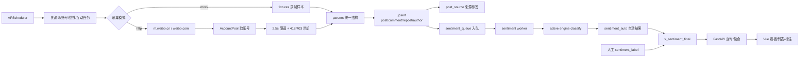
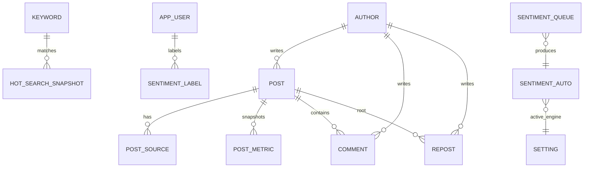

# 微博舆情管理系统 · 系统架构设计

> 对应产品设计：[`docs/10_产品设计文档.md`](10_产品设计文档.md)  
> 对应代码：`backend/`、`frontend/`、`deploy/`  
> 版本：v1.0.0（2026-10-30）  
> 定位：内网单机、小团队（个位数到十几人）使用的微博舆情采集、趋势、标注与情感引擎评估系统。

---

## 1. 系统边界

### 1.1 本期做什么

1. 采集四类数据：关键词搜索结果、命中帖子的评论/转发、指定账号发帖、热搜榜。
2. 数据落 PostgreSQL，前端可查询、筛选、查看详情。
3. 展示声量、情感占比、负面突增、热搜命中、高互动负面帖。
4. 支持多人人工标注（正面/中性/负面），记录标注人，支持修改与进度统计。
5. 自动情感引擎可切换（本地 / LLM），以人工标注评估准确率、F1 和混淆矩阵。

### 1.2 本期不做什么

- 分布式爬虫、代理池、多平台；
- 飞书/邮件等外部告警推送（只在页面标红）；
- 相关性、议题分类、处置工单；
- 公网部署与多租户。

### 1.3 关键约束

- 单机 Docker Compose；
- 不引入 Redis/MQ，任务队列与情感队列都用 PostgreSQL 表 + `FOR UPDATE SKIP LOCKED`；
- 只采集公开内容，不采集私信/非公开主页；
- Cookie 加密存储，仅内网登录用户可用；
- 真实微博采集需要管理员提供 Cookie，代码不实现登录绕过/验证码破解。

---

## 2. 总体架构

### 2.1 运行时拓扑

```text
┌──────────────────────────── Docker Compose（内网单机） ────────────────────────────┐
│                                                                                     │
│  web (nginx + Vue3)          api (FastAPI)                crawler (Python)           │
│   ├ 舆情列表                  ├ /auth                       ├ APScheduler             │
│   ├ 趋势看板                  ├ /posts /trend /hotsearch     ├ 关键词/账号/热搜任务     │
│   ├ 标注工作台                ├ /label /eval                 ├ 评论/转发补抓            │
│   └ 设置                      ├ /config /crawl /sentiment    ├ sentiment worker        │
│          │                    └ JWT + RBAC                   └ 账号池/限速/冷却         │
│          │                           │                              │                  │
│          └────────── /api 反向代理 ──┴──────────────┬───────────────┘                  │
│                                                     ▼                                  │
│                                              PostgreSQL 16                             │
│                         业务表 + 队列表 + v_sentiment_final 视图 + setting              │
└─────────────────────────────────────────────────────────────────────────────────────┘
                                      ▲
                                      │ 公开网页 / m.weibo.cn JSON（可选真实模式）
                                      │
                                  微博站点
```

### 2.2 分层

| 层 | 目录 | 职责 |
|---|---|---|
| 展示层 | `frontend/src` | Vue3 + Element Plus + ECharts，四个页面 |
| 接口层 | `backend/app/routers` | FastAPI 路由、JWT 鉴权、参数校验、响应模型 |
| 业务层 | `backend/app/services` | 情感引擎、趋势聚合、抽样、评估、队列、worker |
| 采集层 | `backend/crawler` | HTTP/Mock 客户端、解析器、账号池、任务、调度器 |
| 数据层 | `backend/app/models.py`、`db.py` | SQLAlchemy 模型、最终情感视图、SQLite/PostgreSQL 兼容 |
| 部署层 | `deploy/` | Docker Compose、Nginx、环境变量模板 |
| 文档层 | `docs/` | 产品设计、架构、API、运行与验收 |

### 2.3 代码目录

```text
backend/
├── app/
│   ├── main.py              FastAPI 入口、CORS、静态前端托管
│   ├── config.py            环境变量配置
│   ├── db.py                引擎、Session、v_sentiment_final
│   ├── models.py            16 张业务表
│   ├── schemas.py           请求/响应模型
│   ├── security.py          PBKDF2、JWT、Cookie 对称加密
│   ├── deps.py              get_db / get_current_user / require_admin
│   ├── seed.py              管理员、演示数据、自动打分
│   ├── routers/             auth/posts/trends/hotsearch/labels/eval/config/crawl/sentiment
│   └── services/            sentiment/final/trends/sampling/metrics/queue/worker
├── crawler/
│   ├── client.py            MockWeiboClient / HttpWeiboClient / AccountPool / 轮换
│   ├── parsers.py           搜索、评论、转发、账号时间线、热搜解析
│   ├── tasks.py             采集任务、幂等 upsert、入队
│   ├── scheduler.py         APScheduler 定时任务
│   ├── worker.py            情感 worker CLI
│   ├── compliance.py        域名白名单、robots、私信路径拦截
│   └── fixtures/            录制样本（search/comments/reposts/timeline/hotsearch）
└── tests/                   API、解析、账号池、队列测试

frontend/
├── src/views/               FeedView / TrendsView / LabelView / SettingsView
├── src/layout/              MainLayout
├── src/api.js               Axios + JWT 拦截器
├── src/router.js            Hash 路由 + 登录/管理员守卫
└── dist/                    构建产物（由 nginx 托管）

deploy/
├── docker-compose.yml       db/api/crawler/web 四个服务
├── nginx.conf               静态文件 + /api 反代
└── .env.example             密钥与模式配置
```

---

## 3. 数据流

### 3.1 采集 → 入库 → 打分 → 展示



### 3.2 采集任务

| 任务 | 频率 | 增量策略 | 去重键 |
|---|---|---|---|
| 关键词搜索 | 15 分钟 | 时间倒序翻页，遇到已入库 mid 或 50 页停止 | `post.mid` |
| 监控账号 | 30 分钟 | 遇到已入库 mid 停止 | `post.mid` |
| 评论 | 新帖 + 24 小时内每 2 小时 | `max_id` 翻页 | `comment.id` |
| 转发 | 转发数 ≥ 20 的帖子 | 翻页遇到已入库停止 | `repost.mid` |
| 热搜 | 10 分钟 | 每次整榜快照 | `(ts, rank)` |
| 情感 worker | 30 秒 | 取 `pending` 队列 | `(text_type, text_id)` |

### 3.3 人工标注 → 最终情感

1. 标注员调用 `GET /label/next` 取一条未被自己标注的文本。
2. `PUT /label/{text_type}/{text_id}` 写入 `sentiment_label`，同一人同一文本唯一，可修改。
3. `v_sentiment_final` 按以下优先级计算：
   - 有人工标注：多数票；票数打平取 `updated_at` 最新一条；
   - 无人工标注：取 `setting.active_engine` 对应引擎的最新 `sentiment_auto`；
   - 都没有：`unscored`。
4. 列表、详情、趋势、Top 负面都只读该视图，保证口径一致。

---

## 4. 数据模型

### 4.1 ER 图



### 4.2 表清单

| 表 | 主键/唯一键 | 作用 |
|---|---|---|
| `keyword` | `id`、`word` 唯一 | 关键词，含临时热搜词 |
| `watch_account` | `id`、`uid` 唯一 | 监控账号 |
| `weibo_cookie` | `id`、`account_name` 唯一 | Cookie 密文、状态、冷却 |
| `author` | `uid` | 作者快照 |
| `post` | `mid` | 帖子正文、互动数、原始 JSON |
| `post_source` | `(mid, source_type, source_value)` | 一个帖子多个来源 |
| `post_metric` | `id` | 互动数时间快照 |
| `comment` | `id` | 评论 |
| `repost` | `mid` | 转发 |
| `hot_search_snapshot` | `(ts, rank)` | 热搜整榜快照 |
| `sentiment_queue` | `(text_type, text_id)` | 待打分队列 |
| `sentiment_auto` | `(text_type, text_id, engine, engine_version)` | 每个引擎一行 |
| `sentiment_label` | `(text_type, text_id, user_id)` | 一人一条人工标注 |
| `app_user` | `id`、`username` 唯一 | 登录用户与角色 |
| `crawl_log` | `id` | 采集任务日志 |
| `setting` | `key` | 当前引擎、阈值等 |

### 4.3 最终情感视图

`v_sentiment_final(text_type, text_id, label, source)`：

- `label`：`pos` / `neu` / `neg` / `NULL`；
- `source`：`manual` / `auto` / `unscored`；
- 人工多数票优先；打平取最新；
- 无人工时取 `active_engine` 最新自动结果；
- SQLite 与 PostgreSQL 共用同一段 CTE + 窗口函数 SQL。

---

## 5. 情感引擎

### 5.1 接口

```python
class SentimentEngine(Protocol):
    name: str
    version: str
    def classify(self, texts: list[str]) -> list[tuple[str, float]]: ...
```

### 5.2 实现

| 引擎 | 实现 | 状态 |
|---|---|---|
| `local` | 优先加载 `output/models/baselines.joblib` 的文本 TF-IDF+SVD+LR；文件缺失时退化为词典模型 | ✅ 可运行；不是设计中的 RoBERTa |
| `llm` | OpenAI 兼容 `/chat/completions`，可配置 base_url/model/key，3 次指数退避 | ✅ 代码完成；未配置 key 时不可用 |
| `mock` | 按文本哈希稳定输出，用于测试/离线演示 | ✅ |

### 5.3 队列与重跑

- 新帖/评论/转发入库即入 `sentiment_queue`；
- worker 用 `FOR UPDATE SKIP LOCKED` 取任务（PostgreSQL），SQLite 本地模式退化为普通事务；
- 结果按 `(text_type, text_id, engine, engine_version)` 幂等 upsert；
- 切换引擎只影响后续打分；
- `POST /sentiment/rerun` 把历史文本重新入队，`POST /sentiment/run-once` 可手动消费一批。

---

## 6. 后端 API

统一前缀 `/api`，除登录/健康检查外都需要 JWT。

| 方法与路径 | 说明 | 权限 |
|---|---|---|
| `POST /auth/login` | 登录，返回 JWT | 公开 |
| `GET /auth/me` | 当前用户 | 登录 |
| `GET /posts` | 列表；keyword/source/time/sentiment/q/min_interactions/分页/排序 | 登录 |
| `GET /posts/{mid}` | 详情：评论、转发、互动曲线 | 登录 |
| `GET /trend/volume` | 声量序列，支持小时/天、关键词拆分 | 登录 |
| `GET /trend/sentiment` | 情感占比序列 | 登录 |
| `GET /trend/alerts` | 负面突增 | 登录 |
| `GET /trend/top-negative` | 高互动负面帖 Top N | 登录 |
| `GET /hotsearch` | 热搜快照/命中 | 登录 |
| `GET /label/next` | 下一条待标注样本 | 登录 |
| `PUT /label/{text_type}/{text_id}` | 提交/修改自己的标注 | 登录 |
| `GET /label/stats` | 个人/整体进度、两两一致率 | 登录 |
| `GET /label/export` | 导出人工标注 JSONL | 登录 |
| `GET /eval` | 各引擎准确率、Macro-F1、混淆矩阵 | 登录 |
| `GET /config/keywords` | 关键词列表 | 登录 |
| `POST/PUT/DELETE /config/keywords` | 关键词管理 | 管理员 |
| `GET /config/accounts` | 监控账号列表 | 登录 |
| `POST/PUT/DELETE /config/accounts` | 监控账号管理 | 管理员 |
| `GET /config/cookies` | Cookie 状态（不返回密文） | 管理员 |
| `POST /config/cookies` | 手动导入 Cookie（加密） | 管理员 |
| `POST /config/cookies/qrcode` | 扫码登录入口 | 管理员 |
| `GET /config/users`、CRUD | 用户管理 | 管理员 |
| `GET/POST /config/engine` | 查看/切换引擎 | 登录/管理员 |
| `POST /sentiment/rerun` | 历史重跑入队 | 管理员 |
| `POST /sentiment/run-once` | 手动消费队列 | 管理员 |
| `GET /sentiment/queue` | 队列状态 | 管理员 |
| `GET /crawl/logs` | 采集日志 | 管理员 |
| `GET /health` | 健康检查 | 公开 |

---

## 7. 前端页面

| 路由 | 页面 | 关键功能 |
|---|---|---|
| `/#/feed` | 舆情列表 | 筛选、卡片流、情感快捷标注、详情抽屉、互动曲线 |
| `/#/trends` | 趋势看板 | 声量、情感堆叠、负面突增、Top 负面、热搜命中 |
| `/#/label` | 标注工作台 | 随机/低置信度/不一致抽样、快捷键、进度与一致率 |
| `/#/settings` | 设置 | 关键词、账号、Cookie、引擎、评估、用户、采集日志 |

- 使用 Hash 路由，Nginx 不需要额外 SPA 回退规则（仍保留 `try_files`）。
- JWT 存 `localStorage`，Axios 请求拦截器统一加 `Authorization`。
- 401 自动清理登录态并跳转登录页。
- 管理员菜单对标注员隐藏，后端仍二次校验。

---

## 8. 安全与合规

### 8.1 认证与权限

- 密码：PBKDF2-HMAC-SHA256，240,000 次迭代，随机盐；
- JWT：HS256，默认 12 小时；
- 角色：`admin` / `annotator`；
- 配置写操作、Cookie、用户、采集日志、重跑仅管理员；
- 所有业务读接口也要求登录，避免内网裸奔。

### 8.2 Cookie 安全

- 使用 Fernet 对称加密后存 `weibo_cookie.cookie_enc`；
- 密钥来自 `COOKIE_ENCRYPTION_KEY`，未设置时由 `JWT_SECRET` 派生；
- API 只返回状态、冷却时间、失败次数，不返回 Cookie 密文/明文；
- 日志不打印 Cookie。

### 8.3 采集合规

- 只允许 `m.weibo.cn`、`weibo.com`、`s.weibo.com` 白名单；
- 网页兜底路径做 robots 检查；
- 私信/聊天/非公开路径直接拒绝；
- 单账号最小请求间隔 2.5 秒，带随机抖动；
- 418/403 冷却 30 分钟，连续 3 次标记异常；
- 原始 JSON 默认保留 90 天，定时清理；
- 不实现登录绕过、验证码破解、代理池。

---

## 9. 部署与运行

### 9.1 Docker Compose

```bash
cd deploy
cp .env.example .env
# 修改 .env 中的密码与密钥
docker compose up -d --build
```

访问：

- 前端：`http://localhost:8080`
- API 文档（服务器本机）：`http://localhost:8000/docs`
- 公网访问：`http://服务器IP:8080`，API 文档走 `http://服务器IP:8080/docs`
- 健康检查：`http://服务器IP:8080/api/health`

> 默认 Compose 把 api 的 8000 端口绑定在 `127.0.0.1`，公网只暴露 web 的 8080；数据库 5432 不映射到宿主机。生产建议再加 HTTPS 与 IP 白名单/VPN。完整的云服务器/域名/HTTPS/安全组步骤见 [`12_云服务器部署与访问控制.md`](12_云服务器部署与访问控制.md)。
>
> **本实例差异**：云服务器 8080 已被同机另一个项目占用，web 映射改为 `8081`；api 仍只绑定 `127.0.0.1:8000`。本文通用示例仍写 8080，实际访问以部署实例为准。

### 9.2 本地开发（SQLite，无需 Docker）

```bash
cd backend
python -m pip install -r requirements-dev.txt
export ADMIN_PASSWORD=admin123   # Windows PowerShell: $env:ADMIN_PASSWORD="admin123"
python -m app.seed --csv ../data/crawl/weibo_1000.csv
uvicorn app.main:app --reload --port 8000
```

另开终端：

```bash
cd frontend
npm install
npm run dev
```

Vite 将 `/api` 代理到 `127.0.0.1:8000`。

### 9.3 采集模式

- `CRAWLER_MODE=mock`：读取 `backend/crawler/fixtures`，不访问微博，适合演示与测试；
- `CRAWLER_MODE=http`：使用 `weibo_cookie` 中已导入的账号访问 m.weibo.cn；需要管理员先导入 Cookie。

```bash
cd backend
python -m crawler.scheduler --once     # 跑一轮
python -m crawler.scheduler            # 常驻调度
python -m crawler.worker --once        # 消费情感队列
```

### 9.4 默认账号

- 管理员：`admin`，密码由 `ADMIN_PASSWORD` 指定；未指定时首次启动随机生成并打印在日志；
- 演示标注员：`annotator / annotator123`（仅在导入演示数据时创建，生产请删除或改密）。

### 9.5 实际部署记录（2026-10-31）

- 服务器：阿里云轻量应用服务器，1.6 GB 内存 / 40 GB 磁盘 / 2 GB Swap；
- 访问：`http://<服务器IP>:8081`，api 仅 `127.0.0.1:8000`，PostgreSQL 5432 不映射；
- 镜像：`weibo-opinion-api:latest`、`weibo-opinion-crawler:latest`、`weibo-opinion-web:latest`、`postgres:16`；
- 低内存处理：前端不在服务器跑 Vite 构建，改为本地 `npm run build` 后上传 `frontend/dist`，用 `frontend/Dockerfile.prebuilt` 构建 Nginx 镜像；
- 已修复的部署问题：
  - `DATABASE_URL` 未读取环境变量，导致 api 回退 SQLite；已在 `config.py` 修复；
  - `.dockerignore` 排除了 `frontend/dist`，导致预构建镜像缺少静态文件；已移除该规则；
  - 上传后的 `assets` 目录权限为 700，Nginx worker 读不到；Dockerfile 中增加 `chmod -R a+rX`；
  - 重建 api 后 Nginx 缓存旧容器 IP，页面 502；运维上执行 `docker compose restart web`；
- 当前数据：`post=1003`、`sentiment_auto=1003`、`hot_search_snapshot≈1360`（mock 调度每 10 分钟写入，数字会持续增长）、`sentiment_label=0`、`comment=0`、`repost=0`、`watch_account=0`；
- 当前引擎：`local` / `lexicon-v1`（词典回退，未打包训练模型）；
- 备份：每日 03:00 `pg_dump`，保留 14 天，已做恢复演练（恢复后 `post=1003`、`sentiment_auto=1003`）；
- 日志：Compose 使用 `json-file`，单文件 10 MB × 3，避免长期运行撑满磁盘。

---

## 10. 测试与验收

### 10.1 自动化测试

```bash
cd backend
python -m pytest tests -q
```

当前覆盖：

- 登录、JWT、管理员/标注员权限；
- 帖子筛选、详情、声量/情感趋势、Top 负面；
- 标注提交、最终情感视图、票数打平取最新；
- 评估指标、导出 JSONL；
- 关键词/Cookie/用户配置；
- 引擎切换与重跑；
- 解析器 fixtures、账号池冷却、Mock 采集幂等。

### 10.2 手工验收链路

1. 启动 Compose；
2. 登录管理员，确认关键词/账号存在；
3. 触发一次采集（mock 或 http），看 `crawl_log`；
4. 看板出现声量/情感曲线；
5. 标注员登录，标注 10 条；
6. 列表/详情的情感变为人工结果；
7. 评估页出现准确率/F1；
8. 切换引擎并重跑，确认旧结果保留、新结果生成。

---

## 11. 当前实现状态与差距

| 能力 | 状态 | 说明 |
|---|---|---|
| PostgreSQL 16 表结构 | ✅ 已在云服务器运行 | 1003 条演示数据；本地 SQLite 也跑通 |
| Docker Compose 四服务 | ✅ 已在云服务器运行 | web 8081；api 仅 `127.0.0.1:8000`；db 不映射 |
| FastAPI + JWT + RBAC | ✅ | 11 个 pytest 通过 |
| Vue3 四页面 | ✅ 构建并浏览器验证 | 四个页面正常出数；未做自动化 E2E |
| 关键词/账号/评论/转发/热搜采集 | 🟡 Mock 跑通；真实未验证 | 当前 `comment=0`、`repost=0`、`watch_account=0`、Cookie 未导入 |
| 账号池/2.5s 限速/418 冷却 | ✅ 单测 | 真实接口行为需线上验证 |
| Cookie 加密 | ✅ | Fernet；密钥可轮换但轮换后旧 Cookie 需重录 |
| 扫码登录 | ⛔ | 返回 501；当前用手动 Cookie 导入 |
| 本地情感引擎 | 🟡 当前 `lexicon-v1` | 支持 TF-IDF+LR 模型文件，但未打包；不是中文 RoBERTa |
| LLM 引擎 | ✅ 代码 / ⛔ 未配置 | 需要 OpenAI 兼容 base_url、key、model |
| 人工标注/最终情感/评估 | ✅ 代码；当前 0 条人工标注 | 人工多数票 + 自动兜底；评估页暂无有意义指标 |
| 负面突增 | ✅ | 前 7 天同时段均值 × 3 且 ≥ 10 条 |
| 告警推送 | ⛔ | 设计非目标，仅页面展示 |
| 分布式/代理池 | ⛔ | 设计非目标 |

---

## 12. 关键设计决策

1. **单 PostgreSQL 承担业务 + 队列**：减少 Redis/MQ 运维；用 `SKIP LOCKED` 支持多 worker。
2. **最终情感做成视图**：列表、趋势、Top 负面共用一套口径，避免各处重复写“人工优先”逻辑。
3. **SQLite 兼容层**：本地无 Docker 也能跑通 API/前端/测试；生产仍推荐 PostgreSQL。
4. **采集默认 mock**：没有 Cookie 时不会误访问微博；真实模式必须显式配置。
5. **人工标注不做“演示假数据”**：演示导入只写自动结果，人工标注留空，评估页如实显示“暂无人工样本”。
6. **前端 Hash 路由**：静态托管简单，Nginx 不需要复杂回退；后续可换 History 路由。
7. **不把本地模型说成 RoBERTa**：当前 `local` 是 TF-IDF+LR 或词典兜底，文档与界面均不宣称 RoBERTa。

---

## 13. 后续演进

1. 接入中文 RoBERTa/小参数 LLM 作为 `local` 正式引擎，保留版本号与回滚。
2. 用 Playwright 完成扫码登录与二维码状态轮询。
3. 增加评论/转发的真实采集与互动曲线回填。
4. 增加事件表与事件级测试集隔离。
5. 告警推送到飞书/邮件（当前非目标）。
6. 多实例部署时把 APScheduler 换成独立调度服务，避免重复调度。
7. 增加 OpenTelemetry/Prometheus 指标与采集成功率告警。
